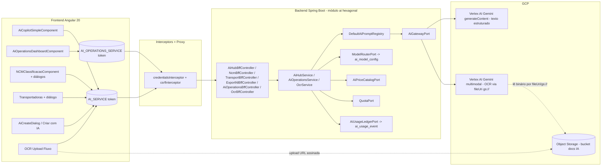
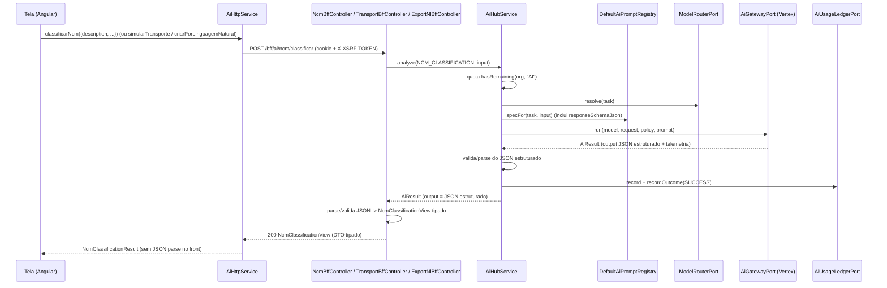
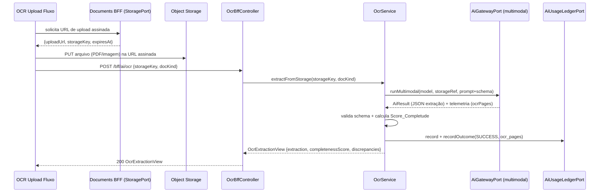

# Design Document

## Overview

Este documento descreve o design do **Escopo B** da feature `assistente-ia-integracao`: transformar o conjunto de telas de IA do EIP num ecossistema que funciona **sem mock**, consumindo um backend real plugado no Vertex AI. O design cobre tanto a **extensão do backend** (módulo `ai`, hexagonal) quanto a **reconexão do frontend** (Angular 20) ao backend real.

### Honestidade sobre o tamanho da entrega

Este não é um ajuste cosmético de frontend. A entrega do Escopo B requer, de forma explícita:

- **Novo deploy do backend no Cloud Run** com uma nova imagem contendo as novas capacidades (`AiTask` novas, novos prompts, novo endpoint de observabilidade, novo fluxo de OCR de binário).
- **Novas migrations Flyway** (a partir de `V24`), para: a seed de roteamento das novas tasks em `ai_model_config`; e, opcionalmente, uma view/índice de agregação para a observabilidade. A maior adição de banco é marginal — o ledger `ai_usage_event` já tem as colunas necessárias (`operation`, `provider`, `model`, `input_units`, `output_units`, `ocr_pages`, `provider_cost`, `latency_ms`, `outcome`, `failure_category`, `created_at`).
- **Sem habilitação de nova API GCP para OCR (decisão definitiva)**: o OCR de documento binário (Requirement 17) usa o **Gemini multimodal já disponível no Vertex**, lendo o binário do object storage por `fileUri`/`gs://`. **Nenhuma nova API GCP** (como Document AI) é habilitada neste escopo; Document AI fica documentado apenas como extensão futura opcional. Ainda assim, esta é a maior adição de backend, pois introduz o tráfego de arquivo binário (via object storage por URL assinada) ao módulo `ai`.
- **Reuso estrito da arquitetura hexagonal existente**: nenhuma capacidade nova pode abrir uma chamada Vertex paralela. Todas passam pelo `AiGatewayPort`, `DefaultAiPromptRegistry`, `ModelRouterPort`, `AiPriceCatalogPort`, `QuotaPort` e pelo ledger `AiUsageLedgerPort`.

### Objetivos de design

1. **Observabilidade real** (Requirement 13): derivar métricas de capacidades de IA do ledger `ai_usage_event`, não de valores fixos.
2. **Saída estruturada** (Requirements 14, 15, 16): reusar o mecanismo `responseSchema` (hoje usado só em `DOCUMENT_EXTRACTION`) para NCM estruturado, simulação de transporte e criação por linguagem natural.
3. **OCR real de binário** (Requirement 17): estender o gateway para extração multimodal a partir de um arquivo armazenado por URL assinada.
4. **Zero mock no front** (Requirement 18): cada tela consome um serviço HTTP real via token DI; os serviços mock só respondem quando a flag `realApis.ai === false`.

### Capacidades e mapeamento tela ↔ backend

| Capacidade (Escopo B) | Tela / Rota | Serviço front (token DI) | Backend | Retorno tipado | Requisito |
|---|---|---|---|---|---|
| Observabilidade de agentes | `/ai-operations/dashboard` | `AI_OPERATIONS_SERVICE` | `GET /bff/ai/operations/metrics` + `GET /bff/ai/operations/errors` (novos) | `CapabilityMetricView[]` / `AiErrorView[]` | 13 |
| NCM estruturado | `/produtos/ncm` + diálogos | `AI_SERVICE` (estendido) | `POST /bff/ai/ncm/classificar` (endpoint dedicado) | `NcmClassificationView` | 14 |
| Simulação de transporte | `/logistica/transportadoras` | `AI_SERVICE` (estendido) | `POST /bff/ai/transporte/simular` (endpoint dedicado) | `TransportSimulationView` | 15 |
| Criação por linguagem natural | `/exportacoes/gerenciar` ("Criar com IA") | `AI_SERVICE` (estendido) | `POST /bff/ai/exportacao/criar-nl` (endpoint dedicado) | `ExportDraftView` | 16 |
| OCR Upload | `/exportacoes/gerenciar` ("OCR Upload") | `AI_SERVICE` (estendido) | `POST /bff/ai/ocr` (novo) | `OcrExtractionView` | 17 |

> **Decisão definitiva de contrato (NCM/transporte/NL):** cada capacidade estruturada expõe um **endpoint BFF dedicado** com um DTO tipado próprio, em vez de empacotar JSON no campo `output` de `/analisar`. Internamente, esses endpoints ainda usam `AiHubService` + as novas `AiTask` + o `responseSchema` do Vertex; é o **BFF** quem faz o `parse`/validação do JSON estruturado e devolve o DTO tipado. O front **não** faz `JSON.parse` de string — consome o DTO diretamente. Isso dá um contrato explícito e mais limpo por capacidade. Observabilidade e OCR, por terem formato de requisição/resposta próprios, também têm endpoints dedicados.

---

## Architecture

### Visão geral (contexto)



### Princípios arquiteturais reusados

- **Hexagonal (ports & adapters)**: o domínio e a aplicação não conhecem o Vertex. Todo acesso ao provedor passa pela porta `AiGatewayPort`, com dois adapters: `MockAiGatewayAdapter` (`@Profile("!cloud")`) e `VertexAiGatewayAdapter` (`@Profile("cloud")`). As novas capacidades **não** adicionam adapters de provedor paralelos; estendem o contrato da porta onde necessário (OCR multimodal). **Decisão definitiva de OCR:** o caminho primário multimodal (`runMultimodal`) é implementado concretamente pelo `VertexAiGatewayAdapter` usando **Gemini multimodal via Vertex** (sem habilitar nova API GCP), lendo o binário do object storage por `fileUri`/`gs://`. Um `DocumentAiGatewayAdapter` dedicado fica como **extensão futura opcional** (documentada, não implementada neste escopo); se adotado, também ficaria atrás do `AiGatewayPort`, nunca como chamada paralela.
- **Prompts na camada de aplicação**: `DefaultAiPromptRegistry.specFor(task, input)` constrói o `AiPromptSpec` (system instruction, user prompt, `responseSchemaJson`, `promptVersion`). O adapter Vertex apenas transporta. As novas tasks adicionam entradas a esse `switch`.
- **Roteamento por configuração**: `ModelRouterPort` resolve o modelo lendo `ai_model_config` (catálogo global, `unique(task, priority)`). Trocar provider/model de qualquer task nova é mudança de dados (migration/seed ou UPDATE), não de código.
- **Ledger como fonte de verdade**: `AiHubService` já registra cada execução em `ai_usage_event` com desfecho (`SUCCESS`/`FAILURE`), telemetria e custo. A observabilidade do Escopo B **lê** desse mesmo ledger.
- **Front por token DI**: cada módulo de front injeta seu serviço por `InjectionToken`, resolvendo para adapter HTTP ou mock conforme `environment.realApis`. O Escopo B segue esse padrão para todos os serviços de IA.

### Fluxo síncrono de uma capacidade estruturada (NCM / transporte / NL)



> **Decisão definitiva de contrato (NCM/transporte/NL):** cada capacidade estruturada expõe um **endpoint BFF dedicado** (`/bff/ai/ncm/classificar`, `/bff/ai/transporte/simular`, `/bff/ai/exportacao/criar-nl`) que devolve um **DTO tipado** (`NcmClassificationView`, `TransportSimulationView`, `ExportDraftView`). Internamente eles reusam o `AiHubService` + as novas `AiTask` + o `responseSchema` do Vertex; é o **BFF** quem faz o `parse`/validação do JSON estruturado e serializa o DTO. O front **não** faz `JSON.parse` de string — recebe o objeto tipado. Esse contrato explícito é mais limpo que empacotar JSON no campo `output` do `/analisar` (opção descartada). A observabilidade e o OCR, por terem formato próprio, também têm endpoints dedicados.

### Fluxo do OCR de binário (Requirement 17)



> **Decisão definitiva (OCR):** o binário **não** trafega pelo corpo do BFF. Reusa-se o `StoragePort` do módulo `document` (URL assinada de upload direto ao object storage, bucket de documentos de IA). O módulo `ai` recebe apenas a `storageKey`; o adapter multimodal lê o arquivo do storage via **Gemini multimodal pelo Vertex**, usando referência `fileUri`/`gs://` (sem habilitar nova API GCP). Essa é a implementação concreta de `runMultimodal` em `@Profile("cloud")`. Document AI permanece como **extensão futura opcional** (`DocumentAiGatewayAdapter`), não implementada neste escopo. Isso mantém o BFF leve e reusa o mecanismo de upload já existente e seguro.

### Perfis e demo-safety

Todo o Escopo B preserva a convenção de profiles: adapters reais em `@Profile("cloud")` (Vertex — incluindo Gemini multimodal para OCR — e GCS) substituem os mocks `@Profile("!cloud")`. A demo local continua funcional com os mocks determinísticos; o ambiente cloud usa os provedores reais.

### Estratégia de deploy

- O pipeline de CD existente (`.github/workflows/cd.yml`) constrói e publica uma nova imagem do backend e aciona uma nova revisão no Cloud Run. Nenhuma mudança estrutural de pipeline é exigida — apenas o fluxo normal de release da nova imagem.
- As novas migrations Flyway (`V24+`) são aplicadas no startup do backend (Flyway já em uso), de forma aditiva e idempotente (seeds com `ON CONFLICT DO NOTHING`, no padrão do `V8`/`V21`).
- Flags `realApis.ai` já são `true` em dev/degustação; nenhuma nova flag de front é necessária, pois todas as capacidades de IA compartilham a mesma flag de domínio `ai`.

---

## Components and Interfaces

### Backend — novas `AiTask` e prompts

Estende-se o enum `AiTask` e o `DefaultAiPromptRegistry` com três novas tasks estruturadas. Nenhuma mudança no `AiGatewayPort` para elas: o `responseSchemaJson` do `AiPromptSpec` já instrui o Vertex a devolver JSON.

```java
// domain/model/AiTask.java (estendido)
public enum AiTask {
    NCM_CLASSIFICATION,   // contrato de saída evoluído p/ JSON estruturado (Req 14)
    DOCUMENT_SUMMARY,
    TRANSLATION,
    RISK_ANALYSIS,
    DOCUMENT_EXTRACTION,
    CHAT,
    TRANSPORT_SIMULATION, // Req 15 (nova)
    EXPORT_NL_CREATION,   // Req 16 (nova)
    OCR_DOCUMENT          // Req 17 (nova, multimodal)
}
```

No `DefaultAiPromptRegistry.specFor(...)`:

- **`NCM_CLASSIFICATION`**: passa a definir um `responseSchemaJson` com `{ ncm: string, confidence: number, rationale: string, alternatives: [{ ncm, confidence, reason }] }`, substituindo o prompt atual "Responda apenas o código NCM". O `promptVersion` muda (ex.: `v2-ncm_classification`), o que invalida corretamente qualquer cache de extração baseado em versão de prompt.
- **`TRANSPORT_SIMULATION`**: `responseSchemaJson` com `{ carrier, modal, route, rationale, estimatedTransitDays?, estimatedCost? }`.
- **`EXPORT_NL_CREATION`**: `responseSchemaJson` espelhando os campos de uma exportação (ex.: `{ incoterm, origin, destination, product, ncm?, quantity, unit, notes }`).

> **Compatibilidade:** a mudança de contrato de `NCM_CLASSIFICATION` afeta quem lia o `output` como string pura. O único consumidor atual é a tela do Assistente (Requirement 2.8/2.9), cujo acceptance critério já prevê exibir score/justificativa "conforme retornados pelo backend". Portanto o Assistente passa a consumir a capacidade NCM tipada (`classificarNcm` → `NcmClassificationView`); a NCM_Tela consome a mesma estrutura completa.

### Backend — endpoints BFF dedicados por capacidade (NCM / transporte / NL)

Cada capacidade estruturada ganha um controller BFF dedicado que invoca o `AiHubService` com a `AiTask` correspondente, faz o `parse`/validação do JSON estruturado produzido pelo `responseSchema` e devolve um DTO tipado. O front **não** recebe string JSON.

```java
// adapter/in/bff/NcmBffController.java (novo) — Req 14
@RestController
@RequestMapping("/bff/ai/ncm")
@RequiredArgsConstructor
public class NcmBffController {
    private final AiHubService aiHub;
    private final StructuredOutputParser parser; // parse + valida contra o record

    @PostMapping("/classificar")
    @PreAuthorize("@rbac.can('ai-operations/painel','create')")
    public NcmClassificationView classificar(@RequestBody @Valid NcmClassifyRequest req) {
        AiResult r = aiHub.analyze(AiTask.NCM_CLASSIFICATION, req.toInputText());
        return parser.parse(r.output(), NcmClassificationView.class); // BFF faz o parse
    }
}

// adapter/in/bff/TransportBffController.java (novo) — Req 15
@RestController
@RequestMapping("/bff/ai/transporte")
@RequiredArgsConstructor
public class TransportBffController {
    private final AiHubService aiHub;
    private final StructuredOutputParser parser;

    @PostMapping("/simular")
    @PreAuthorize("@rbac.can('ai-operations/painel','create')")
    public TransportSimulationView simular(@RequestBody @Valid TransportSimRequest req) {
        AiResult r = aiHub.analyze(AiTask.TRANSPORT_SIMULATION, req.toInputText());
        return parser.parse(r.output(), TransportSimulationView.class);
    }
}

// adapter/in/bff/ExportNlBffController.java (novo) — Req 16
@RestController
@RequestMapping("/bff/ai/exportacao")
@RequiredArgsConstructor
public class ExportNlBffController {
    private final AiHubService aiHub;
    private final StructuredOutputParser parser;

    @PostMapping("/criar-nl")
    @PreAuthorize("@rbac.can('ai-operations/painel','create')")
    public ExportDraftView criarNl(@RequestBody @Valid NlCreateRequest req) {
        AiResult r = aiHub.analyze(AiTask.EXPORT_NL_CREATION, req.command());
        return parser.parse(r.output(), ExportDraftView.class);
    }
}
```

As views tipadas do BFF:

```java
record NcmClassificationView(String ncm, double confidence, String rationale,
                             List<NcmAlternativeView> alternatives) {}
record NcmAlternativeView(String ncm, double confidence, String reason) {}

record TransportSimulationView(String carrier, String modal, String route, String rationale,
                               Integer estimatedTransitDays, BigDecimal estimatedCost) {}

record ExportDraftView(String incoterm, String origin, String destination, String product,
                       String ncm, BigDecimal quantity, String unit, String notes) {}
```

O `StructuredOutputParser` é um colaborador fino análogo ao `ExtractionResultValidator` existente: faz `parse` do JSON e valida campos obrigatórios; JSON inválido vira `AI_RESPONSE_INVALID` (422), sem persistir sucesso. O endpoint existente `POST /bff/ai/analisar` permanece para `CHAT`/`DOCUMENT_SUMMARY`/`TRANSLATION`/`RISK_ANALYSIS`/`DOCUMENT_EXTRACTION` com o `AnalysisView` atual.

### Backend — observabilidade (Requirement 13)

Novo caso de uso de leitura + controller BFF, lendo o ledger agregado.

```java
// domain/port/in/AiOperationsQueryUseCase.java (novo)
public interface AiOperationsQueryUseCase {
    List<CapabilityMetricView> capabilityMetrics(MetricsWindow window);
    List<AiErrorView> recentErrors(int limit);

    record CapabilityMetricView(
        String capability,      // = AiTask.name() (Capacidade_Observavel)
        String label,
        long requests,          // COUNT no período
        long avgResponseTimeMs, // AVG(latency_ms)
        BigDecimal cost,        // SUM(provider_cost)
        Double accuracy,        // null quando não aplicável (Req 13.5)
        String status,          // ACTIVE/DEGRADED/OFFLINE/MAINTENANCE (derivado)
        String lastError,       // última failure_category
        OffsetDateTime lastErrorAt) {}

    record AiErrorView(
        String capability, OffsetDateTime at, String category, String detail) {}

    enum MetricsWindow { LAST_24H, LAST_7D }
}
```

```java
// adapter/in/bff/AiOperationsBffController.java (novo)
@RestController
@RequestMapping("/bff/ai/operations")
@RequiredArgsConstructor
public class AiOperationsBffController {
    private final AiOperationsQueryUseCase useCase;

    @GetMapping("/metrics")
    @PreAuthorize("@rbac.can('ai-operations/painel','view')")
    public List<CapabilityMetricView> metrics() {
        return useCase.capabilityMetrics(MetricsWindow.LAST_24H);
    }

    @GetMapping("/errors")
    @PreAuthorize("@rbac.can('ai-operations/painel','view')")
    public List<AiErrorView> errors() {
        return useCase.recentErrors(50);
    }
}
```

**Derivação das métricas (porta de saída de leitura):** uma nova porta `AiUsageAnalyticsPort` com um adapter JPA que executa agregações sobre `ai_usage_event` (filtrando por `organization_id` via RLS e por janela de tempo). O `Status_Capacidade` é derivado por regra determinística:

- `OFFLINE`: nenhuma execução `SUCCESS` na janela e ao menos uma `FAILURE`.
- `DEGRADED`: proporção de `FAILURE` acima de um limiar (ex.: 20%) ou `avg(latency_ms)` acima de um limiar.
- `MAINTENANCE`: a task está desabilitada no `ai_model_config` (`enabled = false`).
- `ACTIVE`: caso contrário.

**Decisão definitiva de acurácia (Req 13.4/13.5):** `accuracy` é derivada **apenas onde há sinal real** — a confiança média (`confidence`) registrada por `NCM_CLASSIFICATION` e por `OCR_DOCUMENT`. Para todas as demais capacidades (`CHAT`, `DOCUMENT_SUMMARY`, `TRANSLATION`, `RISK_ANALYSIS`, `DOCUMENT_EXTRACTION`, `TRANSPORT_SIMULATION`, `EXPORT_NL_CREATION`) o backend retorna `accuracy = null` (nunca um valor fixo/inventado). A UI do AI Operations Center renderiza explicitamente **"n/a"** quando `accuracy` é `null`, deixando claro que não há sinal de acurácia para aquela capacidade.

### Backend — OCR multimodal (Requirement 17)

Estende-se o `AiGatewayPort` com um método de execução multimodal, mantendo o adapter como transporte puro.

```java
// domain/port/out/AiGatewayPort.java (estendido)
public interface AiGatewayPort {
    default AiResult run(AiModel model, AiRequest request) { /* existente */ }
    AiResult run(AiModel model, AiRequest request, AiExecutionPolicy policy, AiPromptSpec prompt);

    // NOVO (Req 17): execução multimodal a partir de referência de arquivo no storage.
    // storageRef traz a chave/URI do objeto (ex.: gs://bucket/key) e o mediaType.
    AiResult runMultimodal(AiModel model, AiRequest request, AiExecutionPolicy policy,
                           AiPromptSpec prompt, StorageRef storageRef);

    record StorageRef(String uri, String mediaType) {}
}
```

- `MockAiGatewayAdapter` implementa `runMultimodal` devolvendo uma extração determinística (demo-safe).
- `VertexAiGatewayAdapter` implementa `runMultimodal` (implementação concreta primária, `@Profile("cloud")`) montando um `contents` com uma `part` de `fileData` (`fileUri` apontando para `gs://bucket/key` + `mimeType`) além do `text`, usando **Gemini multimodal via Vertex** (sem habilitar nova API GCP) e o mesmo `responseSchema` para extração estruturada. O binário é lido diretamente do object storage pela referência `fileUri`/`gs://`.
- **Extensão futura opcional (não implementada neste escopo):** um `DocumentAiGatewayAdapter` dedicado, caso se opte por Document AI no futuro; nesse caso ele também ficaria atrás do `AiGatewayPort` (ou de uma sub-porta), nunca como chamada paralela. Documentado aqui apenas como caminho de evolução.

```java
// domain/port/in/OcrExtractionUseCase.java (novo)
public interface OcrExtractionUseCase {
    OcrExtractionView extract(OcrCommand cmd);

    record OcrCommand(String storageKey, String mediaType, String docKind) {}

    record OcrExtractionView(
        String docKind,
        Object extraction,            // DTO estruturado validado
        int completenessScore,        // 0..100 (Score_Completude)
        List<String> discrepancies,   // ex.: "peso divergente no packing list"
        boolean needsReview,          // completenessScore < limiar
        String provider, String model, int ocrPages) {}
}
```

```java
// adapter/in/bff/OcrBffController.java (novo)
@RestController
@RequestMapping("/bff/ai/ocr")
@RequiredArgsConstructor
public class OcrBffController {
    private final OcrExtractionUseCase useCase;

    @PostMapping
    @PreAuthorize("@rbac.can('ai-operations/painel','create')")
    public OcrExtractionView ocr(@RequestBody @Valid OcrRequest req) {
        return useCase.extract(new OcrCommand(req.storageKey(), req.mediaType(), req.docKind()));
    }

    public record OcrRequest(@NotBlank String storageKey,
                             @NotBlank String mediaType,
                             @NotBlank String docKind) {}
}
```

O `OcrService` (aplicação) resolve o modelo (`router.resolve(OCR_DOCUMENT)`), checa `quota`, monta o `AiPromptSpec` com schema de extração, chama `gateway.runMultimodal`, valida o resultado com o `ExtractionResultValidator` existente, calcula o `Score_Completude` (razão de campos obrigatórios presentes/total) e registra no ledger — exatamente o pipeline do `AiHubService`, com a diferença da origem multimodal.

### Backend — reconhecimento no `AiHubService`

As novas tasks estruturadas (`TRANSPORT_SIMULATION`, `EXPORT_NL_CREATION`) percorrem o caminho síncrono já existente em `AiHubService.analyze(...)`. O `NCM_CLASSIFICATION` continua pelo mesmo caminho; apenas o prompt/schema muda. O OCR tem serviço próprio por causa do fluxo multimodal, mas reusa os mesmos colaboradores (`router`, `quota`, `priceCatalog`, `ledger`, `extractionValidator`).

### Frontend — serviços e tokens

**AI_SERVICE estendido (`IAiService`)** — adiciona as operações que faltam e as novas capacidades estruturadas:

```ts
export interface IAiService {
  // existentes
  analisar(req: AiAnalyzeRequest): Observable<AiAnalysisResult>;
  reconciliar(req: AiReconcileRequest): Observable<AiReconciliationResult>;
  // Req 8 (já previstos no Escopo A)
  analisarAsync(req: AiAnalyzeRequest): Observable<AiJobView>;
  jobStatus(id: string): Observable<AiJobView>;
  uso(): Observable<AiUsageView[]>;
  router(): Observable<AiModelRouteView[]>;
  // Escopo B — capacidades estruturadas (endpoints BFF dedicados; retorno já tipado)
  classificarNcm(req: NcmClassifyRequest): Observable<NcmClassificationResult>; // Req 14 → POST /bff/ai/ncm/classificar
  simularTransporte(req: TransportSimRequest): Observable<TransportSimResult>;   // Req 15 → POST /bff/ai/transporte/simular
  criarPorLinguagemNatural(req: NlCreateRequest): Observable<ExportDraft>;       // Req 16 → POST /bff/ai/exportacao/criar-nl
  ocr(req: OcrRequest): Observable<OcrExtractionResult>;                         // Req 17 → POST /bff/ai/ocr
}
```

- `AiHttpService` implementa chamando os **endpoints dedicados** reais sob `${environment.bffBaseUrl}/bff/ai`: `classificarNcm` → `POST /bff/ai/ncm/classificar`, `simularTransporte` → `POST /bff/ai/transporte/simular`, `criarPorLinguagemNatural` → `POST /bff/ai/exportacao/criar-nl`, `ocr` → `POST /bff/ai/ocr`. Cada endpoint já devolve o **DTO tipado** correspondente — o front **não** executa `JSON.parse` de nenhuma string de `output`; o `HttpClient` desserializa o JSON do corpo da resposta diretamente para o tipo do contrato.
- `AiMockAdapter` implementa todas as operações de forma determinística, para a demo com `realApis.ai === false`.

**AI_OPERATIONS_SERVICE (novo token)** — para a tela de observabilidade:

```ts
export interface IAiOperationsService {
  getCapabilities(filters?: AiOperationsFilters): Observable<CapabilityMetric[]>;
  getMetrics(): Observable<AiOperationsMetrics>;
  getErrors(capability?: string): Observable<AiErrorEntry[]>;
}

export const AI_OPERATIONS_SERVICE = new InjectionToken<IAiOperationsService>('AiOperationsService');

export const aiOperationsServiceProvider: Provider = {
  provide: AI_OPERATIONS_SERVICE,
  useClass: environment.realApis?.ai ? AiOperationsHttpService : AiOperationsMockAdapter
};
```

- `AiOperationsHttpService` chama `GET /bff/ai/operations/metrics` e `GET /bff/ai/operations/errors` e adapta ao shape `AiAgent`/`AiOperationsMetrics`/`AiErrorEntry` que a tela já usa.
- `AiOperationsMockAdapter` renomeia o atual `AiOperationsMockService` para servir apenas como fallback mock. A tela deixa de injetar `AiOperationsMockService` diretamente e passa a injetar o token.

**Componentes a reconectar:**

- `AiCopilotSimpleComponent` (`/home-logged/assistente-ia`): já coberto pelos Requirements 1-12; para NCM (Req 2) passa a consumir `AI_SERVICE.classificarNcm` **tipado** (`NcmClassificationResult`), exibindo `ncm`/`confidence`/`rationale`/alternativas sem fazer `JSON.parse` de string.
- `AiOperationsDashboardComponent` (`/ai-operations/dashboard`): injeta `AI_OPERATIONS_SERVICE` em vez de `AiOperationsMockService`; renderiza "n/a" quando `accuracy` é `null`.
- `NCMClassificacaoComponent` + `classificacao-form-dialog`: injeta `AI_SERVICE` e usa `classificarNcm` (retorno tipado), removendo `NCMClassificationMockService` do caminho real.
- `transportadoras.component.ts` (+ diálogo de simulação): usa `AI_SERVICE.simularTransporte`.
- `AiCreateDialogComponent` + fluxo em `/exportacoes/gerenciar`: usa `AI_SERVICE.criarPorLinguagemNatural` e exibe o rascunho para confirmação.
- Fluxo "OCR Upload" em `/exportacoes/gerenciar`: faz upload via `StoragePort` (serviço de documentos existente) e chama `AI_SERVICE.ocr`.

### Tratamento de RBAC/CSRF

Todas as chamadas de IA do front usam o `HttpClient`, e os interceptors `credentialsInterceptor` + `csrfInterceptor` anexam cookie de sessão e `X-XSRF-TOKEN` automaticamente. Os endpoints novos preservam o mesmo RBAC: `ai-operations/painel` (view/create). Nenhum segredo vai ao front.

---

## Data Models

### Backend — modelos de domínio (novos/alterados)

```java
// Resultado estruturado de NCM (parse do output do Vertex) — Req 14
record NcmClassification(String ncm, double confidence, String rationale,
                         List<NcmAlternative> alternatives) {}
record NcmAlternative(String ncm, double confidence, String reason) {}

// Resultado estruturado de simulação de transporte — Req 15
record TransportSimulation(String carrier, String modal, String route, String rationale,
                           Integer estimatedTransitDays, BigDecimal estimatedCost) {}

// Rascunho de exportação proposto — Req 16
record ExportDraft(String incoterm, String origin, String destination, String product,
                   String ncm, BigDecimal quantity, String unit, String notes) {}
```

Esses records são produzidos pelo `responseSchema` do Vertex e validados pelo `StructuredOutputParser` (análogo ao `ExtractionResultValidator`: parse + checagem de campos obrigatórios). Para NCM/transporte/NL, o parse/validação acontece **no BFF** (nos controllers dedicados), que então serializa os DTOs tipados (`NcmClassificationView`, `TransportSimulationView`, `ExportDraftView`) no corpo da resposta — o front recebe objetos tipados, nunca uma string JSON em `output`.

### Backend — persistência (ledger reusado)

A tabela `ai_usage_event` **não muda de estrutura** — já possui tudo que a observabilidade precisa. Os novos valores de `operation` serão `TRANSPORT_SIMULATION`, `EXPORT_NL_CREATION`, `OCR_DOCUMENT` (além dos existentes).

```
ai_usage_event (V8 + V19 + V23)
  id, organization_id (RLS), user_id,
  operation,            -- = AiTask.name()  → Capacidade_Observavel
  provider, model,
  input_units, output_units, ocr_pages,
  provider_cost (18,6), eip_credits,
  request_id, idempotency_key, created_at,
  thinking_tokens, total_tokens, finish_reason, latency_ms,
  outcome, failure_category, trace_id
índices: (organization_id, created_at DESC), (organization_id, operation)
```

### Backend — roteamento (seed novo via migration)

Nova migration `V24__ai_scope_b_router.sql` adiciona as rotas das novas tasks ao catálogo global `ai_model_config` (mantendo `unique(task, priority)` e o padrão `ON CONFLICT (id) DO NOTHING`):

```sql
-- V24__ai_scope_b_router.sql  (ADITIVO; ai_model_config é GLOBAL, sem RLS)
INSERT INTO ai_model_config (id, provider, model, task, priority, cost_class,
                             thinking_level, max_output_tokens, thinking_supported)
VALUES
  (gen_random_uuid(), 'vertex-ai', 'gemini-3.8-flash', 'TRANSPORT_SIMULATION', 'STANDARD', 'medium', 'MEDIUM', 2048, true),
  (gen_random_uuid(), 'vertex-ai', 'gemini-3.8-flash', 'EXPORT_NL_CREATION',   'STANDARD', 'medium', 'MEDIUM', 2048, true),
  (gen_random_uuid(), 'vertex-ai', 'gemini-3.8-flash', 'OCR_DOCUMENT',         'STANDARD', 'medium', 'MEDIUM', 2048, true)
ON CONFLICT (task, priority) DO NOTHING;
```

> Observação: a migration real deve seguir o estilo das existentes (ids fixos como no `V8`, ou `gen_random_uuid()` se a extensão estiver habilitada). O `thinking_budget_tokens` (V22) deve ser definido quando `thinking_supported = true`, conforme a regra de fail-fast do resolver.

### Backend — observabilidade (view opcional)

Para evitar agregações caras repetidas, uma migration opcional `V25__ai_usage_metrics_view.sql` pode criar uma **view** de agregação por `(organization_id, operation)` sobre janelas de tempo. Alternativamente, as agregações ficam em consultas JPQL/nativas no `AiUsageAnalyticsPort` sem objeto de banco novo. O design prefere consultas no adapter (menos superfície de migration), deixando a view como otimização futura.

### Frontend — tipos (novos/estendidos)

```ts
// types/ai-hub.ts (estendido)
export interface AiJobView { jobId: string; status: string; }
export interface AiUsageView { feature: string; label: string; used: number; included: number; unit: string; percent: number; }
export interface AiModelRouteView { task: string; priority: string; provider: string; model: string; enabled: boolean; }

export interface NcmClassifyRequest { description: string; productName?: string; scientificName?: string; commodityType?: string; }
export interface NcmClassificationResult { ncm: string; confidence: number; rationale: string; alternatives: { ncm: string; confidence: number; reason: string }[]; }

export interface TransportSimRequest { origin: string; destination: string; product: string; quantityTons: number; preferredModal: string; incoterm: string; desiredDate: string; }
export interface TransportSimResult { carrier: string; modal: string; route: string; rationale: string; estimatedTransitDays?: number; estimatedCost?: number; }

export interface NlCreateRequest { command: string; }
export interface ExportDraft { incoterm: string; origin: string; destination: string; product: string; ncm?: string; quantity: number; unit: string; notes?: string; }

export interface OcrRequest { storageKey: string; mediaType: string; docKind: string; }
export interface OcrExtractionResult { docKind: string; extraction: unknown; completenessScore: number; discrepancies: string[]; needsReview: boolean; provider: string; model: string; ocrPages: number; }
```

```ts
// types/ai-operations.ts (reusado; shape mantido p/ a tela)
// CapabilityMetric adapta CapabilityMetricView do backend ao AiAgent já consumido pela tela.
export interface CapabilityMetric {
  capability: string;      // operation / AiTask
  label: string;
  requests24h: number;
  avgResponseTime: number;
  cost: number;
  accuracy: number | null; // null quando não aplicável; a UI renderiza "n/a"
  status: 'ACTIVE' | 'DEGRADED' | 'OFFLINE' | 'MAINTENANCE';
  lastError: string | null;
  lastErrorAt: string | null;
}
```
---

## Correctness Properties

*Uma propriedade é uma característica ou comportamento que deve valer para todas as execuções válidas do sistema — essencialmente uma afirmação formal sobre o que o sistema deve fazer. Propriedades servem de ponte entre especificações legíveis por humanos e garantias de corretude verificáveis por máquina.*

O Escopo B é, em grande parte, reconexão de UI + integração (que são melhor cobertas por testes de exemplo/integração). Ainda assim, há um núcleo de **lógica pura** que se beneficia de testes baseados em propriedade: o parse/serialização das saídas estruturadas da IA, a agregação do ledger para observabilidade, a derivação de status, o invariante de registro no ledger e o cálculo do score de completude. As propriedades abaixo cobrem esse núcleo (após reflexão para eliminar redundância entre os round-trips).

### Property 1: Round-trip de saída estruturada

*Para qualquer* objeto estruturado válido produzido por uma capacidade de IA do Escopo B (`NcmClassificationView`, `TransportSimulationView`, `ExportDraftView` ou extração de OCR), o `StructuredOutputParser` do BFF ao serializar o objeto para JSON e em seguida parseá-lo de volta deve produzir um objeto equivalente ao original (DTO tipado); e *para qualquer* JSON que não satisfaça o schema correspondente, o parse deve sinalizar erro (`AI_RESPONSE_INVALID`) em vez de produzir um DTO inválido.

**Validates: Requirements 14.2, 14.3, 15.3, 16.3, 17.4**

### Property 2: Invariância da agregação de métricas

*Para qualquer* conjunto de eventos do ledger `ai_usage_event`, a métrica agregada por capacidade (`operation`) deve satisfazer: `requests` igual à contagem de eventos daquela capacidade na janela; `cost` igual à soma de `provider_cost`; `avgResponseTimeMs` igual à média de `latency_ms`; e `accuracy` presente (não-`null`) **apenas** para as capacidades acuráveis `NCM_CLASSIFICATION` e `OCR_DOCUMENT` (confiança média) e ausente (`null`) para todas as demais — sem nenhum valor fixo. Quando `accuracy` é `null`, a UI renderiza "n/a".

**Validates: Requirements 13.2, 13.3, 13.4, 13.5**

### Property 3: Derivação determinística do status da capacidade

*Para qualquer* conjunto de desfechos recentes de uma capacidade, o `Status_Capacidade` derivado deve seguir a regra: `OFFLINE` quando não há execução `SUCCESS` e há ao menos uma `FAILURE`; `DEGRADED` quando a proporção de `FAILURE` ou a latência média excede o limiar configurado; `MAINTENANCE` quando a capacidade está desabilitada no `ai_model_config`; e `ACTIVE` caso contrário.

**Validates: Requirements 13.6**

### Property 4: Invariante de registro no ledger

*Para qualquer* execução bem-sucedida de qualquer capacidade do Escopo B, o pipeline deve gravar exatamente um registro no ledger com `outcome = SUCCESS`, `operation` igual ao nome da `AiTask` executada e a telemetria correspondente (`provider`, `model`, unidades, `provider_cost`, e `ocr_pages > 0` quando a capacidade é OCR); e *para qualquer* execução que falhe com um erro de IA, deve existir exatamente um registro com `outcome = FAILURE` e a `failure_category` correspondente.

**Validates: Requirements 15.6, 16.7, 17.9, 18.2**

### Property 5: Invariante do score de completude

*Para qualquer* resultado de extração de OCR, o `Score_Completude` deve satisfazer `0 <= score <= 100`, deve ser igual a 100 se e somente se todos os campos obrigatórios do schema estiverem presentes, e `needsReview` deve ser verdadeiro se e somente se `score` for menor que o limiar configurado.

**Validates: Requirements 17.4, 17.6**

---

## Error Handling

### Taxonomia de erros de IA (reusada)

O backend já mapeia a taxonomia de erros via `AiExceptionHandler`, preservada integralmente para todas as capacidades do Escopo B:

| Erro de domínio | HTTP | Semântica | Ação na tela |
|---|---|---|---|
| `AI_QUOTA_EXCEEDED` | 402 | Franquia de IA esgotada | Oferecer "Comprar créditos de IA" |
| `AI_RATE_LIMITED` | 429 (+ `Retry-After`) | Rate limit | Informar tempo de espera antes de nova tentativa |
| `AI_TIMEOUT` | 504 | Timeout do provedor | Indisponibilidade temporária + "tentar novamente" |
| `AI_UNAVAILABLE` | 503 | Circuit breaker aberto | Indisponibilidade temporária + "tentar novamente" |
| `AI_PROVIDER_ERROR` | 502/503 | Erro do provedor | Indisponibilidade temporária + "tentar novamente" |
| `AI_RESPONSE_INVALID` | 422 | Resposta inválida/incompleta do provedor | "A resposta da IA foi inválida para a solicitação" |

**Nenhuma tela substitui um erro de IA por resposta mockada ou fallback local** (Requirements 6.6, 13.12, 14.11, 15.9, 16.9, 17.12, 18.6). Com `realApis.ai === true`, erros reais do backend sobem para a tela.

### Erros específicos do Escopo B

- **Saída estruturada inválida** (NCM/transporte/NL): se o Vertex devolver JSON que não satisfaz o `responseSchema`, o `AiResponseValidator`/validador de extração lança erro → `AI_RESPONSE_INVALID` (422). O front exibe a mensagem; nada é persistido como sucesso (segue o padrão já aplicado em `DOCUMENT_EXTRACTION`).
- **OCR — formato não suportado** (Req 17.8): validado no front antes do upload (lista de `mediaType` aceitos) e no backend (`OcrRequest` valida `mediaType`); formato inválido impede o envio sem chamar o provedor.
- **OCR — baixa completude** (Req 17.6): não é erro; é um sinal (`needsReview = true`) exibido para revisão humana.
- **OCR — discrepância** (Req 17.7): divergências (ex.: peso do packing list) retornam em `discrepancies[]` e são destacadas, sem bloquear o fluxo.
- **RBAC negado** (Req 18.5): 403 do backend → mensagem genérica de acesso negado, sem vazar detalhes internos.
- **Observabilidade indisponível** (Req 13.12): falha ao buscar métricas exibe indicação de indisponibilidade sem substituir por mock e sem bloquear o resto da tela.

### Registro de falhas no ledger

O caminho de falha de `AiHubService`/`OcrService` usa `ledger.recordFailureOutcome(...)` em transação `REQUIRES_NEW`, de modo que a linha `FAILURE` sobrevive ao rollback quando a exceção é relançada. Isso garante que a observabilidade (Requirement 13.7/13.8) enxergue falhas reais, incluindo as das novas capacidades.

### Humano no circuito

Nenhuma capacidade confirma ação de negócio automaticamente a partir de uma saída de IA (Requirements 14.8, 15.7, 16.5, 17.10, 18 transversal). A IA sugere; a pessoa revisa, ajusta e confirma. Para a Criação Inteligente, a exportação só é criada após confirmação explícita da `Estrutura_Exportacao_Proposta`.

---

## Testing Strategy

### Abordagem dual

- **Testes de exemplo (unit)**: cobrem interações de UI, exibição de campos, validação de obrigatórios, limiares, mapeamento de erro e fluxo de humano no circuito. São a maioria dos casos do Escopo B, por serem reconexão de tela.
- **Testes de integração**: cobrem a conversa real tela ↔ BFF ↔ Vertex (com provedor mockado no backend), o fluxo de upload por URL assinada + OCR, e a verificação de que, com `realApis.ai === true`, nenhum serviço mock é instanciado.
- **Testes de propriedade**: cobrem o núcleo de lógica pura (as 5 propriedades acima). São complementares aos de exemplo.

### Biblioteca de testes de propriedade

- **Backend (Java)**: usar **jqwik** (property-based testing para JUnit 5) — não implementar PBT do zero. Mínimo de **100 iterações** por teste de propriedade.
- **Frontend (TypeScript)**: usar **fast-check** com o runner existente (Jasmine/Karma ou Jest, conforme o projeto). Mínimo de **100 iterações** por propriedade. Aplicável às propriedades que vivem no front (ex.: parse do `output` estruturado, cálculo de `needsReview` por limiar).

### Mapeamento propriedade → teste

Cada teste de propriedade referencia a propriedade de design via tag no comentário:

`// Feature: assistente-ia-integracao, Property {n}: {texto da propriedade}`

| Propriedade | Camada | Alvo de teste | Estratégia |
|---|---|---|---|
| Property 1 (round-trip estruturado) | back + front | serialização/parse de `NcmClassification`, `TransportSimulation`, `ExportDraft`, extração OCR | gerar objetos válidos aleatórios; `parse(serialize(x)) ≡ x`; JSON inválido → erro. Parametrizar por tipo para evitar 4 testes redundantes. |
| Property 2 (agregação de métricas) | back | `AiUsageAnalyticsPort`/serviço de métricas | gerar listas de eventos; comparar agregação com cálculo de referência; checar `accuracy` null para não-acuráveis |
| Property 3 (derivação de status) | back | função de status | gerar misturas SUCCESS/FAILURE/latência; verificar enum derivado contra a regra |
| Property 4 (invariante de ledger) | back | pipeline `analyze`/`extract` com gateway mockado | para qualquer execução sucesso/falha, exatamente 1 registro com o `outcome`/telemetria esperados |
| Property 5 (score de completude) | back + front | cálculo de `Score_Completude` | gerar extrações com subconjuntos de campos; verificar `0..100`, `==100 ⟺ todos obrigatórios`, `needsReview ⟺ score < limiar` |

### Testes de exemplo e integração (destaques)

- **Observabilidade**: componente injeta `AI_OPERATIONS_SERVICE` real; com backend mockando o ledger, verifica exibição de requests/tempo/custo e lista de erros; verifica que `AiOperationsMockService` não é injetado quando `realApis.ai === true`.
- **NCM**: diálogo chama `AI_SERVICE.classificarNcm`, exibe `ncm/confidence/rationale` e alternativas; bloqueia envio sem descrição; sinaliza revisão abaixo do limiar.
- **Transporte**: diálogo valida campos obrigatórios; exibe recomendação + justificativa.
- **Criação NL**: comando vazio bloqueado; rascunho exibido para confirmação; exportação criada só após confirmar.
- **OCR**: fluxo de upload por URL assinada (mock de storage), chamada ao `/bff/ai/ocr`, exibição de extração + score + discrepâncias; formato inválido bloqueado.
- **Erros de IA**: para cada capacidade, simular 402/429/504/503/422 e verificar a mensagem/ação correspondente, sem fallback mock.

### Testes arquiteturais (restrições do Escopo B)

- **ArchUnit** (ou equivalente) para garantir que nenhuma capacidade nova chama o Vertex fora do `AiGatewayPort` (Requirements 18.1, 17.3): nenhuma dependência de `VertexAiCaller`/`VertexAiGatewayAdapter` fora do pacote `adapter.out.ai`.
- Verificação de que as novas tasks têm entrada em `ai_model_config` (roteamento por configuração, Req 18.7).

### Observação sobre o que NÃO é PBT

- Infra/deploy (Req 18.8), configuração de APIs GCP e wiring de Cloud Run não são testados por propriedade; são verificados por smoke tests de startup (migrations aplicadas, beans de profile `cloud` ativos) e pelo pipeline de CD.
- O comportamento do próprio Vertex (incluindo Gemini multimodal) e do CloudWatch/observabilidade do provedor não é alvo de PBT; integração com 1-2 exemplos cobre o "fio ligado".
