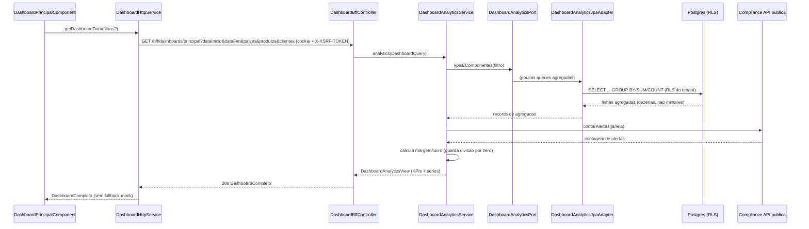

# Design Document

## Overview

Este documento descreve o design da feature `dashboard-principal-integracao`: integrar a tela **Dashboard Principal** (`DashboardPrincipalComponent`, rota `/home-logged/dashboards/principal`) com serviços reais do backend, **removendo todo o mock do caminho real**, e **evoluir o backend** (módulo `export`, Spring Modulith hexagonal) para alimentar com dados reais os KPIs que hoje não têm fonte (lucro/margem e embarcado/pendente), além de integrar a contagem de compliance via API pública do módulo.

### Honestidade sobre o tamanho da entrega

Esta não é uma troca cosmética de serviço no front. A entrega exige, de forma explícita:

- **Backend novo**: um caso de uso de analytics dedicado (`DashboardAnalyticsUseCase`), uma porta de saída de leitura/agregação dedicada (`DashboardAnalyticsPort`), um adapter JPA de agregação, e dois endpoints BFF (`Analytics_Endpoint` + `Catalogos_Endpoint`).
- **Novas migrations Flyway (a partir de `V25` — a última aplicada é `V24`)**: adição aditiva de **custo** e de **estado de embarque** à tabela `export`, mais os **índices** necessários para a agregação eficiente por país/produto.
- **Evolução de domínio**: o POJO `Exportacao` (domínio puro, sem JPA), a `ExportacaoEntity`, o `ExportacaoMapper` e os fluxos de criação/edição/confirmação passam a carregar custo e embarque; um novo caso de uso de marcação de embarque é introduzido, idempotente via optimistic locking (`@Version`).
- **Novo deploy do backend no Cloud Run** (profile `cloud`), com a nova imagem contendo os endpoints, o domínio evoluído e as migrations. Localmente o backend roda no profile `local`.
- **Reconexão do frontend**: `IDashboardService`, `DASHBOARD_SERVICE` (token DI), `DashboardHttpService`, `DashboardMockAdapter` (reusando o `DashboardMockService` existente como fallback) e a flag `environment.realApis.dashboard` (dev e prod).

### Objetivos de design (reuso, OO, SOLID, idempotência, performance, eficácia)

Estes objetivos não são apenas citados: cada seção abaixo mostra concretamente como são atingidos.

1. **Reuso estrito dos padrões existentes.** Nada é inventado do zero: a agregação espelha o padrão canônico de analytics tenant-scoped do módulo `ai` (`AiUsageAnalyticsAdapter` + `AiUsageEventJpaRepository`, com `@Query` JPQL + interface projections + `Pageable`). O domínio puro + mapper manual seguem o padrão de `Exportacao`/`ExportacaoEntity`/`ExportacaoMapper`. O front reusa o padrão de token DI (`InjectionToken` + provider por flag `realApis`), os interceptors `credentialsInterceptor`/`csrfInterceptor`, o `errorInterceptor` + `toAiFriendlyError`/`AiFriendlyError`, e o próprio `DashboardMockService` como mock adapter.
2. **SOLID.** SRP: o analytics é um caso de uso dedicado, não sobrecarrega `ListarExportacoesUseCase`. ISP: uma porta de leitura dedicada (`DashboardAnalyticsPort`) separada da porta de escrita do agregado (`ExportacaoRepositoryPort`). DIP: a aplicação depende das portas, não dos adapters. OCP: adicionar uma nova dimensão de série é adicionar um método de agregação, sem alterar os existentes.
3. **Performance e eficácia (correção do gargalo atual).** O `ExportacaoService.dashboard()` atual carrega até **10.000 linhas** (`repo.listar(org, null, 0, 10000)`) e agrega em loop Java. O novo `Analytics_Endpoint` **não repete isso**: usa **agregação pushdown no Postgres** (`GROUP BY`/`SUM`/`COUNT`) com projeções, materializando apenas as linhas agregadas (poucas dezenas), sob índices adequados — sem N+1.
4. **Idempotência.** O `Analytics_Endpoint` e o `Catalogos_Endpoint` são **GET sem efeito colateral**, naturalmente idempotentes e cacheáveis (ETag opcional). A nova mutação de embarque é idempotente por construção (marcar embarcado 2× = 1× de efeito), garantida por optimistic locking (`@Version` + `ConcurrentModificationConflictException`) e, quando exposta por POST, por `Idempotency-Key` (reusando `IdempotencyService`).
5. **Modularidade (Spring Modulith).** A contagem de compliance é obtida pela **API pública do módulo `compliance`** (porta/caso de uso), nunca por query cross-módulo direta às tabelas de outro módulo.

### Mapeamento KPI/série → fonte → estratégia

| Indicador | Fonte | Deriva hoje? | Estratégia de agregação |
|---|---|---|---|
| `total_exportacoes` | `SUM(export.total_amount)` | Sim | pushdown `SUM` |
| `contratos_ativos` | `COUNT(status = CONFIRMADA)` | Sim | pushdown `COUNT` filtrado |
| `exportacoesPorMes` | `GROUP BY date_trunc('month', created_at)` | Sim | pushdown `GROUP BY` + `SUM` |
| `exportacoesPorPais` | `GROUP BY destination_country` | Sim | pushdown `GROUP BY` + `SUM`; percentual derivado |
| `exportacoesPorProduto` | `GROUP BY export_item.product_id/description` | Sim | pushdown `GROUP BY` + `SUM(quantity*unit_price)` |
| `total_embarcado` / `total_pendente` | nova `Flag_Embarque` | **Não — Escopo C** | migration `V25` + pushdown `SUM` condicional |
| `lucro_estimado` / `margem_media` | `total_amount` − novo `total_cost` | **Não — Escopo C** | migration `V25` + pushdown `SUM`; margem calculada na app |
| `alertas_compliance` | API pública módulo `compliance` | integração | porta pública de contagem |
| catálogos (países/produtos/clientes) | `DISTINCT` em dados reais | Sim | `Catalogos_Endpoint` |

---

## Architecture

### Visão geral (contexto)

```mermaid
flowchart LR
  subgraph FE[Frontend Angular 20]
    DP[DashboardPrincipalComponent]
    TOK[(DASHBOARD_SERVICE token)]
    HTTP[DashboardHttpService]
    MOCK[DashboardMockAdapter extends DashboardMockService]
  end

  subgraph INT[Interceptors]
    CRED[credentialsInterceptor + csrfInterceptor]
    ERR[errorInterceptor -> toAiFriendlyError]
  end

  subgraph BE[Backend Spring Boot - modulo export hexagonal]
    BFF[DashboardBffController]
    UC[DashboardAnalyticsService]
    PORTR[DashboardAnalyticsPort - porta OUT leitura]
    ADP[DashboardAnalyticsJpaAdapter]
    JPAR[ExportAnalyticsJpaRepository - @Query JPQL + projections]
    EXPUC[Criar/Editar/Confirmar/MarcarEmbarque UseCases]
    EXPPORT[ExportacaoRepositoryPort - porta OUT escrita]
    IDEMP[IdempotencyService]
  end

  subgraph MOD[Modulo compliance - API publica]
    CPORT[ComplianceAlertCountPort / UseCase publico]
  end

  subgraph DB[(Postgres - RLS por tenant)]
    EXPORT[(export + export_item + customer + product)]
    SCREEN[(compliance screening)]
  end

  DP --> TOK
  TOK -->|realApis.dashboard=true| HTTP
  TOK -->|realApis.dashboard=false| MOCK
  HTTP --> CRED --> BFF
  BFF -.erros.-> ERR
  BFF --> UC
  UC --> PORTR --> ADP --> JPAR -->|GROUP BY/SUM/COUNT| EXPORT
  UC --> CPORT --> SCREEN
  EXPUC --> EXPPORT --> EXPORT
  EXPUC --> IDEMP
```

### Princípios arquiteturais reusados

- **Hexagonal estrito + Spring Modulith.** Fluxo: porta IN (caso de uso, com records de command/view aninhados) → `@Service` de aplicação → porta OUT → adapter. Espelha `ExportacaoService` (que implementa `CriarExportacaoUseCase` + `ConfirmarExportacaoUseCase` + `ListarExportacoesUseCase`). O analytics ganha **seu próprio** caso de uso para não ferir SRP.
- **Agregação tenant-scoped (RLS).** O padrão canônico é o `AiUsageAnalyticsAdapter`: um repositório Spring Data JPA com `@Query` JPQL devolvendo **interface projections** e, quando preciso, `Pageable` para limite; o adapter mapeia as projeções para records de domínio. O dashboard é **do próprio tenant** → usa **RLS normal** (a sessão do Postgres carrega o `organization_id` do tenant corrente), **não** o caminho de reporting cross-tenant.
- **Contraste de performance (referência, não aplicável aqui).** O `superadmin/MetricsJpaAdapter` usa `reportingJdbcTemplate` (role `eip_report`, BYPASSRLS) porque agrega **todos** os tenants. O dashboard é por tenant, então **não** usa esse caminho — fica apenas como referência de que agregações pesadas devem ser pushdown no banco, não em memória.
- **Domínio puro + mapper manual.** `Exportacao` é POJO sem anotações JPA; `ExportacaoEntity` + `ExportacaoMapper` fazem a ponte (`toEntity`/`toDomain`, replace-all de itens). As evoluções de custo/embarque passam por **domínio → entity → mapper → migration**, mantendo o domínio livre de JPA.
- **Front por token DI.** `DASHBOARD_SERVICE = new InjectionToken<IDashboardService>(...)`; provider `useClass: environment.realApis?.dashboard ? DashboardHttpService : DashboardMockAdapter`, registrado em `app.config.ts`. Os interceptors `credentialsInterceptor` + `csrfInterceptor` anexam sessão + CSRF; o `errorInterceptor` normaliza erros com `toAiFriendlyError`.

### Fluxo síncrono de uma requisição de dashboard



### Estratégia de queries (performance — poucas queries, zero N+1)

O objetivo é que **uma** requisição de dashboard dispare **poucas queries agregadas** — idealmente **uma por série + uma de KPIs escalares + uma de compliance** — e **nunca** carregue linhas individuais de `export`/`export_item`. Concretamente:

1. **KPIs escalares (uma query):** `SUM(total_amount)`, `SUM(CASE WHEN shipped THEN total_amount END)`, `SUM(CASE WHEN NOT shipped THEN total_amount END)`, `SUM(total_amount - COALESCE(total_cost,0))`, `SUM(total_amount)` (receita p/ margem), `COUNT(*) FILTER (WHERE status='CONFIRMADA')` — tudo em um único `SELECT` com os mesmos predicados de filtro.
2. **Série por mês (uma query):** `GROUP BY date_trunc('month', created_at)`.
3. **Série por país (uma query):** `GROUP BY destination_country` com `SUM(total_amount)`; o **percentual** é derivado na aplicação (ou via window function `SUM(...) OVER ()`), evitando segunda varredura.
4. **Série por produto (uma query):** join `export_item` + `GROUP BY product_id` (ou `description`), `SUM(quantity * unit_price)`.
5. **Compliance (uma chamada):** à API pública do módulo (que resolve sua própria query sob RLS).

Comparação explícita de eficácia:

| Aspecto | `dashboard()` atual (gargalo) | `Analytics_Endpoint` novo |
|---|---|---|
| Linhas materializadas | até 10.000 entidades + itens | dezenas (apenas grupos) |
| Local da agregação | loop Java em memória | pushdown no Postgres |
| Risco de N+1 | alto (itens LAZY) | nenhum (joins agregados) |
| Escalabilidade | degrada linearmente com volume | limitada pela cardinalidade de grupos |

### Índices necessários (migration)

A tabela `export` já tem `idx_export_org_status`, `idx_export_org_created`, `idx_export_org_customer`. Para as novas agregações, propõe-se na migration aditiva:

- `idx_export_org_country (organization_id, destination_country)` — série/filtro por país.
- `idx_export_org_shipped (organization_id, shipped)` — KPIs embarcado/pendente.
- `idx_export_item_product (export_id, product_id)` ou `(product_id)` conforme o plano — série por produto.

> As agregações mensais já se apoiam em `idx_export_org_created`. Índices parciais (`WHERE shipped`) podem ser avaliados se o volume justificar; proposta conservadora acima.

### Estratégia de deploy

- O CD existente (`.github/workflows/cd.yml`) constrói e publica a nova imagem do backend e aciona nova revisão no Cloud Run. Nenhuma mudança estrutural de pipeline.
- As migrations `V25+` são aplicadas no startup pelo Flyway, de forma **aditiva e idempotente** (ALTER TABLE aditivo no padrão do `V22`; seeds, se houver, com `ON CONFLICT DO NOTHING`).
- Nova flag de front `environment.realApis.dashboard` em dev e prod; sem segredos no front.

---

## Components and Interfaces

### Backend — caso de uso de analytics (porta IN, SRP)

Um caso de uso **dedicado**, separado de `ListarExportacoesUseCase`, com uma view rica. O endpoint legado `GET /bff/exportacoes/dashboard` (contadores simples) **permanece deprecado** (sem remoção imediata, para não quebrar consumidores), e passa a delegar à mesma porta de agregação para parar de carregar 10.000 linhas; a recomendação é marcá-lo `@Deprecated` e migrar os consumidores ao novo endpoint.

```java
// domain/port/in/DashboardAnalyticsUseCase.java (novo) — Req 2, 3, 5, 6, 7
public interface DashboardAnalyticsUseCase {

    DashboardAnalyticsView analytics(DashboardQuery query);

    OptionsFiltersView catalogos();

    // Filtro vindo do BFF (todos opcionais; ausência = sem restrição).
    record DashboardQuery(
            OffsetDateTime dataInicio,
            OffsetDateTime dataFim,
            List<String> paises,
            List<UUID> produtos,
            List<UUID> clientes) {}

    record DashboardAnalyticsView(
            KpisView kpis,
            List<SerieMesView> exportacoesPorMes,
            List<SeriePaisView> exportacoesPorPais,
            List<SerieProdutoView> exportacoesPorProduto) {}

    record KpisView(
            BigDecimal totalExportacoes,
            BigDecimal totalEmbarcado,
            BigDecimal totalPendente,
            BigDecimal lucroEstimado,
            BigDecimal margemMedia,     // 0..1 (ou 0..100 conforme contrato front)
            long contratosAtivos,
            long alertasCompliance) {}

    record SerieMesView(String mes, BigDecimal valor) {}
    record SeriePaisView(String pais, BigDecimal valor, BigDecimal percentual) {}
    record SerieProdutoView(String produto, BigDecimal valor) {}

    record OptionsFiltersView(List<String> paises, List<CatalogoItem> produtos, List<CatalogoItem> clientes) {}
    record CatalogoItem(UUID id, String label) {}
}
```

### Backend — porta de saída de leitura/agregação (ISP, DIP)

Porta **dedicada** de leitura, separada de `ExportacaoRepositoryPort` (que serve o agregado de escrita e expõe apenas `salvar`/`porId`/`listar`). Não poluir a porta de escrita com métodos de analytics é ISP aplicado.

```java
// domain/port/out/DashboardAnalyticsPort.java (novo)
public interface DashboardAnalyticsPort {

    // KPIs escalares em UMA passada (SUM/COUNT condicionais).
    KpiAggregate aggregateKpis(ExportFilter filter);

    List<MonthlyBucket> aggregateByMonth(ExportFilter filter);
    List<CountryBucket> aggregateByCountry(ExportFilter filter);
    List<ProductBucket> aggregateByProduct(ExportFilter filter);

    // Catalogos (DISTINCT) tenant-scoped.
    List<String> distinctCountries();
    List<CatalogoRow> distinctProducts();
    List<CatalogoRow> distinctCustomers();

    record ExportFilter(OffsetDateTime from, OffsetDateTime to,
                        List<String> countries, List<UUID> products, List<UUID> customers) {}

    record KpiAggregate(BigDecimal totalAmount, BigDecimal shippedAmount,
                        BigDecimal pendingAmount, BigDecimal totalCost, long confirmedCount) {}

    record MonthlyBucket(String month, BigDecimal amount) {}
    record CountryBucket(String country, BigDecimal amount) {}
    record ProductBucket(UUID productId, String description, BigDecimal amount) {}
    record CatalogoRow(UUID id, String label) {}
}
```

### Backend — adapter JPA de agregação (reuso do padrão canônico)

Espelha `AiUsageAnalyticsAdapter`: `@Component`, delega a um repositório Spring Data JPA com `@Query` JPQL + **interface projections**, mapeia projeções para records de domínio. RLS restringe as linhas ao tenant corrente — **nenhum** `organization_id` manual no `WHERE` além do que a RLS já aplica (igual ao padrão do módulo `ai`).

```java
// adapter/out/persistence/DashboardAnalyticsJpaAdapter.java (novo)
@Component
@RequiredArgsConstructor
public class DashboardAnalyticsJpaAdapter implements DashboardAnalyticsPort {

    private final ExportAnalyticsJpaRepository jpa;

    @Override
    public KpiAggregate aggregateKpis(ExportFilter f) {
        var p = jpa.aggregateKpis(f.from(), f.to(), nullIfEmpty(f.countries()),
                                  nullIfEmpty(f.products()), nullIfEmpty(f.customers()));
        return new KpiAggregate(
                coalesce(p.getTotalAmount()), coalesce(p.getShippedAmount()),
                coalesce(p.getPendingAmount()), coalesce(p.getTotalCost()), p.getConfirmedCount());
    }
    // aggregateByMonth / aggregateByCountry / aggregateByProduct seguem o mesmo mapeamento
    // de projection -> record; distinct* devolvem catalogos.
}

// adapter/out/persistence/ExportAnalyticsJpaRepository.java (novo)
public interface ExportAnalyticsJpaRepository extends Repository<ExportacaoEntity, UUID> {

    @Query("""
        select
          coalesce(sum(e.totalAmount),0) as totalAmount,
          coalesce(sum(case when e.shipped = true then e.totalAmount else 0 end),0) as shippedAmount,
          coalesce(sum(case when e.shipped = false then e.totalAmount else 0 end),0) as pendingAmount,
          coalesce(sum(e.totalAmount - coalesce(e.totalCost,0)),0) as totalCost,
          sum(case when e.status = 'CONFIRMADA' then 1 else 0 end) as confirmedCount
        from ExportacaoEntity e
        where (:from is null or e.createdAt >= :from)
          and (:to is null or e.createdAt < :to)
          and (:countries is null or e.destinationCountry in :countries)
          and (:customers is null or e.customerId in :customers)
    """)
    KpiProjection aggregateKpis(OffsetDateTime from, OffsetDateTime to,
                                List<String> countries, List<UUID> products, List<UUID> customers);

    interface KpiProjection {
        BigDecimal getTotalAmount(); BigDecimal getShippedAmount(); BigDecimal getPendingAmount();
        BigDecimal getTotalCost(); long getConfirmedCount();
    }
    // aggregateByMonth / aggregateByCountry / aggregateByProduct: @Query JPQL com GROUP BY
    // e projections (MonthlyProjection, CountryProjection, ProductProjection).
}
```

> **Decisão de performance:** a agregação por produto exige join com `export_item`; quando o filtro de `produtos` está presente, ele é aplicado no join dessa query (`item.productId in :products`), e nas demais queries o filtro de produto é aplicado por `exists`/subconsulta para não duplicar linhas de `export`. Isso evita materializar itens e evita N+1.

### Backend — serviço de aplicação (DIP + cálculo puro de margem)

```java
// application/DashboardAnalyticsService.java (novo)
@Service
@RequiredArgsConstructor
public class DashboardAnalyticsService implements DashboardAnalyticsUseCase {

    private final DashboardAnalyticsPort analytics;      // porta OUT (DIP)
    private final ComplianceAlertCountPort compliance;   // API publica do modulo compliance

    @Override
    @Transactional(readOnly = true)
    public DashboardAnalyticsView analytics(DashboardQuery q) {
        var filter = toFilter(q);
        var kpi = analytics.aggregateKpis(filter);
        var meses = analytics.aggregateByMonth(filter).stream().map(/* -> SerieMesView */).toList();
        var paises = toCountrySeries(analytics.aggregateByCountry(filter)); // percentual aqui
        var produtos = analytics.aggregateByProduct(filter).stream().map(/* -> SerieProdutoView */).toList();
        long alertas = compliance.contarAlertas(q.dataInicio(), q.dataFim());

        BigDecimal receita = kpi.totalAmount();
        BigDecimal lucro = kpi.totalCost(); // ja = sum(total_amount - coalesce(cost,0))
        BigDecimal margem = Margem.calcular(lucro, receita); // guarda divisao por zero
        // ...
    }
}

// domain/model/Margem.java — logica pura, testavel por propriedade
public final class Margem {
    public static BigDecimal calcular(BigDecimal lucro, BigDecimal receita) {
        if (receita == null || receita.signum() == 0) return BigDecimal.ZERO; // Req 5.4
        return lucro.divide(receita, 6, RoundingMode.HALF_UP);
    }
}
```

A derivação do percentual por país (Req 2.5) acontece na aplicação a partir do total agregado, garantindo que a soma dos percentuais seja ~100% (ver Property 1).

### Backend — endpoints BFF

```java
// adapter/in/bff/DashboardBffController.java (novo)
@RestController
@RequestMapping("/bff/dashboards/principal")
@RequiredArgsConstructor
public class DashboardBffController {

    private final DashboardAnalyticsUseCase useCase;

    @GetMapping
    @PreAuthorize("@rbac.can('dashboards/principal','view') or @rbac.can('exportacoes/gerenciar','view')")
    public DashboardAnalyticsView analytics(
            @RequestParam(required = false) OffsetDateTime dataInicio,
            @RequestParam(required = false) OffsetDateTime dataFim,
            @RequestParam(required = false) List<String> paises,
            @RequestParam(required = false) List<UUID> produtos,
            @RequestParam(required = false) List<UUID> clientes) {
        return useCase.analytics(new DashboardQuery(dataInicio, dataFim, paises, produtos, clientes));
    }

    @GetMapping("/filtros")
    @PreAuthorize("@rbac.can('dashboards/principal','view') or @rbac.can('exportacoes/gerenciar','view')")
    public OptionsFiltersView filtros() {
        return useCase.catalogos();
    }
}
```

> **Idempotência/cache (Req — GET sem efeito colateral):** ambos os endpoints são `GET` idempotentes. Como otimização **opcional**, o controller pode emitir `ETag` derivado de `(filtro + max(updated_at) do tenant)` e responder `304` em `If-None-Match`, reduzindo recomputação. Não é obrigatório para a entrega.

### Backend — compliance via API pública do módulo (Modulith)

A contagem de alertas **não** acessa as tabelas do módulo `compliance` diretamente. Expõe-se (ou reusa-se) uma **porta/caso de uso público** do compliance:

```java
// modulo compliance — API publica (porta de contagem) — Req 7
public interface ComplianceAlertCountPort {
    // Conta screenings do tenant em estado pendente ou alto risco, opcionalmente por janela.
    long contarAlertas(OffsetDateTime from, OffsetDateTime to);
}
```

Se um método de contagem ainda não existir no compliance, ele é **adicionado** à API pública do módulo (não um acesso cross-schema). O `DashboardAnalyticsService` depende da **interface pública**, mantendo o acoplamento entre módulos no contrato permitido pelo Spring Modulith.

### Backend — evolução de domínio e marcação de embarque (OO + idempotência)

O domínio puro `Exportacao` ganha custo e embarque, mantendo-se livre de JPA:

```java
// domain/model/Exportacao.java (evoluido) — Req 5.5, 6.4
public final class Exportacao {
    // ... campos existentes ...
    private BigDecimal totalCost;        // custo total (nullable => tratado como zero no analytics)
    private boolean shipped;             // Flag_Embarque
    private OffsetDateTime shippedAt;    // quando embarcou (null se nao embarcado)

    // Idempotente: marcar embarcado 2x == 1x (f(f(x)) == f(x)).
    public void marcarEmbarcado(OffsetDateTime quando) {
        if (this.shipped) return;        // ja embarcado: no-op (idempotencia)
        this.shipped = true;
        this.shippedAt = quando;
    }

    public void definirCusto(BigDecimal custo) {
        this.totalCost = custo; // validacao de nao-negativo no construtor/setter de dominio
    }
}
```

> **Decisão de modelagem (justificativa OO/clareza):** optou-se por **flag booleana `shipped` + timestamp `shipped_at`** em vez de adicionar um valor `EMBARCADO` ao enum `ExportacaoStatus`. Razão: embarque é **ortogonal** ao ciclo `RASCUNHO → CONFIRMADA → CANCELADA` (uma exportação `CONFIRMADA` pode estar embarcada ou não), e colapsar as duas dimensões num único enum violaria a coesão do estado (SRP do agregado) e exigiria estados combinatórios. A flag + timestamp é mais limpa, preserva o enum existente e registra **quando** embarcou. O custo é um `total_cost` na própria `export` (nível de cabeçalho), suficiente para lucro/margem; custo por item fica como evolução futura caso necessário.

```java
// domain/port/in/MarcarEmbarqueUseCase.java (novo) — Req 6.4
public interface MarcarEmbarqueUseCase {
    ExportacaoView marcarEmbarcado(UUID exportId, OffsetDateTime quando);
}
```

A implementação carrega o agregado (`repo.porId`), chama `marcarEmbarcado(...)` e persiste. A **idempotência** é garantida em duas camadas: (1) o domínio faz no-op quando já embarcado; (2) o optimistic locking (`@Version` na `ExportacaoEntity`) + `ConcurrentModificationConflictException` no `ExportacaoJpaAdapter` protegem contra atualizações concorrentes. Se a operação for exposta via **POST** no BFF, aceita `Idempotency-Key` reusando o `IdempotencyService` (mesmo padrão de `ExportacaoBffController.criar`), de modo que uma retentativa com a mesma chave não produza efeito adicional.

A `ExportacaoEntity` recebe `total_cost`, `shipped`, `shipped_at` (colunas novas); o `ExportacaoMapper` propaga esses campos em `toEntity`/`toDomain`. Os fluxos **criar/editar/confirmar** passam a aceitar/preservar custo; marcar embarque é fluxo próprio.

### Backend — migration Flyway (aditiva, idempotente) — `V25`

```sql
-- V25__export_cost_and_shipment.sql  (ADITIVO; tabela export tem RLS por tenant)
ALTER TABLE export ADD COLUMN IF NOT EXISTS total_cost  numeric(18,2);
ALTER TABLE export ADD COLUMN IF NOT EXISTS shipped     boolean NOT NULL DEFAULT false;
ALTER TABLE export ADD COLUMN IF NOT EXISTS shipped_at  timestamptz;

-- indices de suporte as novas agregacoes (Req 2.5, 2.6, 6.2/6.3)
CREATE INDEX IF NOT EXISTS idx_export_org_country ON export (organization_id, destination_country);
CREATE INDEX IF NOT EXISTS idx_export_org_shipped ON export (organization_id, shipped);
CREATE INDEX IF NOT EXISTS idx_export_item_product ON export_item (product_id);
```

> `total_cost` é **nullable** (custo ausente = tratado como zero no cálculo de lucro/margem — Req 5.6, documentado). `shipped` tem default `false`, de modo que exportações pré-existentes contam como **pendentes** até serem marcadas. Padrão `ADD COLUMN IF NOT EXISTS` + `CREATE INDEX IF NOT EXISTS` garante idempotência da migration no padrão aditivo do `V22`.

### Frontend — serviço, interface e token DI (reuso do padrão)

```ts
// src/types/dashboard.ts (reusado; shapes mantidos) — ja existe
// IDashboardService (novo) — Req 1.5
export interface IDashboardService {
  getDashboardData(filtros?: FiltrosDashboard): Observable<DashboardCompleto>;
  getOptionsFilters(): Observable<OptionsFilters>;
}

export const DASHBOARD_SERVICE = new InjectionToken<IDashboardService>('DashboardService');

// provider registrado em app.config.ts (mesmo padrao de AI_SERVICE/EXPORTACAO_SERVICE)
export const dashboardServiceProvider: Provider = {
  provide: DASHBOARD_SERVICE,
  useClass: environment.realApis?.dashboard ? DashboardHttpService : DashboardMockAdapter
};
```

- **`DashboardHttpService`** (novo) implementa `IDashboardService` chamando `${environment.bffBaseUrl}/bff/dashboards/principal` (analytics) e `.../filtros` (catálogos). Converte `FiltrosDashboard` em query params (período ISO, listas de países/produtos/clientes) e **mapeia** a `DashboardAnalyticsView` do backend para o `DashboardCompleto` que a tela já consome. Erros sobem normalizados pelo `errorInterceptor` (`AiFriendlyError`); **nunca** há fallback para mock quando `realApis.dashboard === true`.
- **`DashboardMockAdapter`** (novo) `extends DashboardMockService implements IDashboardService` — reusa o mock determinístico existente como fallback (mesmo padrão de `AiOperationsMockAdapter`), ativo apenas quando `realApis.dashboard === false`.
- **`DashboardPrincipalComponent`** passa a **injetar `DASHBOARD_SERVICE`** (não mais `DashboardMockService` diretamente) e remove quaisquer dados hardcoded (Req 1.2, 1.6). Mantém filtros, 7 KPIs e 3 gráficos, re-solicitando dados quando filtros mudam (Req 3.7) e ao "Limpar Filtros" (Req 3.6).

### Frontend — flags de ambiente

```ts
// environment.ts e environment.prod.ts
export const environment = {
  // ...
  realApis: {
    // ... flags existentes
    dashboard: true   // dev e prod; false apenas para demo local com mock
  }
};
```

### Tratamento de RBAC/CSRF/erros

As chamadas usam `HttpClient`; `credentialsInterceptor` + `csrfInterceptor` anexam cookie de sessão e `X-XSRF-TOKEN`. O `errorInterceptor` + `toAiFriendlyError` normalizam falhas em `AiFriendlyError`, reusado pela tela para exibir mensagens (incluindo acesso negado em 403, sem vazar detalhes internos — Req 9.3). Nenhum segredo no front (Req 9.4).

---

## Data Models

### Frontend — contratos (reusados, sem mudança de shape)

Os tipos de `src/types/dashboard.ts` **permanecem**: `DashboardData` (7 KPIs), `ExportacoesPorMes`, `ExportacoesPorPais` (com `percentual`), `ExportacoesPorProduto`, `FiltrosDashboard`, `OptionsFilters`, `DashboardCompleto`. O `DashboardHttpService` adapta a view do backend a esses tipos, de modo que a tela não muda de contrato.

### Backend — domínio (evoluído)

```
Exportacao (POJO puro)
  id, organizationId, legalEntityId?, customerId?, reference, status (ExportacaoStatus),
  destinationCountry, incoterm, totalAmount (18,2), currency, version,
  totalCost (18,2, nullable)   ← NOVO (Req 5)
  shipped (boolean)            ← NOVO (Req 6)
  shippedAt (timestamptz?)     ← NOVO (Req 6)
  itens: List<ItemExportacao> (productId, description, quantity 18,3, unitPrice 18,2)
```

### Backend — persistência (`export`, evoluída via `V25`)

```
export  (V3 + V25)
  id, organization_id (RLS), legal_entity_id, customer_id, reference, status,
  destination_country, incoterm, total_amount (18,2), currency, version,
  created_at, updated_at,
  total_cost (18,2 NULL)              ← V25
  shipped (boolean NOT NULL false)    ← V25
  shipped_at (timestamptz NULL)       ← V25
  indices: (org,status), (org,created_at desc), (org,customer_id),
           (org,destination_country) ← V25, (org,shipped) ← V25

export_item (V3)
  export_id, product_id, description, quantity (18,3), unit_price (18,2)
  indice: (product_id) ← V25

customer (V3): name, country       product (V3): ncm, description
```

### Backend — records de agregação (projeções → domínio)

Os records de `DashboardAnalyticsPort` (`KpiAggregate`, `MonthlyBucket`, `CountryBucket`, `ProductBucket`, `CatalogoRow`) são produzidos a partir de **interface projections** do repositório JPA — exatamente o padrão de `CapabilityAggregateProjection` em `AiUsageEventJpaRepository`. Nenhum record de agregação carrega linhas individuais de exportação.

---

## Correctness Properties

*Uma propriedade é uma característica ou comportamento que deve valer para todas as execuções válidas do sistema — essencialmente uma afirmação formal sobre o que o sistema deve fazer. Propriedades servem de ponte entre especificações legíveis por humanos e garantias de corretude verificáveis por máquina.*

Grande parte desta feature é reconexão de UI + integração (melhor coberta por testes de exemplo/integração). Mas há um **núcleo de lógica pura e determinística** que se beneficia de testes baseados em propriedade: a agregação (soma por grupo vs. total), a partição embarcado/pendente, o cálculo de margem/lucro (com guarda de divisão por zero) e a idempotência da marcação de embarque. As quatro propriedades abaixo cobrem esse núcleo após reflexão para eliminar redundância (as três invariantes de agregação de 2.2/2.5/2.6 foram consolidadas em uma propriedade parametrizada por dimensão).

### Property 1: Invariância da agregação (soma dos grupos = soma total; percentuais ~100%)

*Para qualquer* conjunto de exportações do tenant e qualquer dimensão de agrupamento (mês, país ou produto), a soma dos valores agregados por grupo deve ser igual à soma de `total_amount` do mesmo conjunto filtrado (modelo de referência em memória vs. agregação pushdown), e, para a série por país, a soma dos `percentual` de todos os grupos deve ser igual a 100% dentro de uma tolerância de arredondamento (ou 0% quando o conjunto é vazio).

**Validates: Requirements 2.2, 2.5, 2.6**

### Property 2: Cálculo de margem e lucro (guarda de divisão por zero e custo ausente)

*Para qualquer* receita (`SUM(total_amount)`) e custo agregados, o `lucro_estimado` deve ser igual a `receita - custo` (com custo ausente tratado como zero); e a `margem_media` deve ser igual a `lucro / receita` quando a receita é maior que zero, e exatamente zero quando a receita é zero, sem nunca lançar erro de divisão.

**Validates: Requirements 5.2, 5.3, 5.4, 5.6**

### Property 3: Partição embarcado/pendente

*Para qualquer* conjunto de exportações filtradas, a soma de `total_embarcado` (exportações com `shipped = true`) mais a soma de `total_pendente` (exportações com `shipped = false`) deve ser igual ao `total_exportacoes` (soma de `total_amount`) do mesmo conjunto filtrado.

**Validates: Requirements 6.2, 6.3, 6.5**

### Property 4: Idempotência da marcação de embarque

*Para qualquer* exportação em um estado arbitrário, aplicar `marcarEmbarcado` duas vezes deve produzir o mesmo estado final que aplicá-la uma única vez (`shipped = true` e `shipped_at` estável após a primeira marcação), ou seja, a operação é idempotente (`f(f(x)) = f(x)`) e, com a mesma `Idempotency-Key`, não gera efeito adicional.

**Validates: Requirements 6.4**

---

## Error Handling

### Normalização de erros (reuso)

Erros do backend sobem pelo `HttpClient` e são normalizados pelo `errorInterceptor` em `AiFriendlyError` via `toAiFriendlyError` (reuso do que já existe em `src/types/ai-error.ts` / `src/app/http/error.interceptor.ts`). A tela consome esse tipo uniforme para exibir mensagens.

| Situação | HTTP | Comportamento na Dashboard_Tela |
|---|---|---|
| Período sem dados | 200 (payload zerado) | KPIs em zero + gráficos em estado vazio (Req 8.1) |
| Falha ao buscar analytics | 5xx/4xx | Mensagem de erro ao usuário; **sem** fallback mock (Req 8.2, 8.4) |
| Falha ao buscar catálogos | 5xx/4xx | Indica filtros indisponíveis **sem** bloquear dados já carregados (Req 8.3) |
| RBAC negado | 403 | Mensagem genérica de acesso negado, sem vazar detalhes (Req 9.3) |
| CSRF/sessão ausente | 401/403 | Fluxo de reautenticação existente dos interceptors |

### Regras específicas

- **Sem fallback para mock no caminho real.** Com `realApis.dashboard === true`, um erro do backend **nunca** é substituído por dados do `DashboardMockAdapter` (Req 8.4). O mock só existe quando a flag é `false`.
- **Divisão por zero (margem).** Tratada no domínio (`Margem.calcular`): receita zero ⇒ margem zero, sem exceção (Req 5.4).
- **Custo ausente.** Normalizado para zero na agregação (`COALESCE(total_cost,0)`), documentado, sem inventar lucro/margem (Req 5.6).
- **Conflito de concorrência na marcação de embarque.** O optimistic locking lança `ConcurrentModificationConflictException` (reuso); o BFF a traduz em `409 Conflict`. Como a operação é idempotente, uma retentativa que encontre o estado já embarcado resulta em no-op bem-sucedido.
- **Estado de carregamento.** Enquanto a requisição está em andamento, a tela mostra indicador de carregamento (Req 8.5) e, ao concluir, anuncia a atualização via `aria-live` (Req 10.4).

---

## Testing Strategy

### Abordagem dual

- **Testes de exemplo (unit):** cobrem wiring de DI (provider resolve `DashboardHttpService` quando `realApis.dashboard=true` e não instancia mock), mapeamento view→`DashboardCompleto`, formatação pt-BR, estados vazio/erro/loading, acessibilidade (alt textual + `aria-live`), catálogos distintos, e `contratos_ativos`.
- **Testes de integração:** cobrem a conversa tela ↔ BFF (com repositório/DB de teste), a propagação de filtros como query params, os headers `cookie` + `X-XSRF-TOKEN`, RBAC 403, e a contagem de alertas via **API pública do compliance** (mockada) com 1–3 exemplos.
- **Testes de propriedade:** cobrem o núcleo de lógica pura (as 4 propriedades acima), complementares aos de exemplo.

### Bibliotecas de teste de propriedade

- **Backend (Java):** **jqwik** (JUnit 5) — não implementar PBT do zero. Mínimo de **100 iterações** por propriedade.
- **Frontend (TypeScript):** **fast-check** no runner existente — mínimo de **100 iterações** por propriedade (aplicável às propriedades de cálculo que vivam no front, caso o mapeamento de margem/percentual seja replicado no `DashboardHttpService`).

Cada teste referencia a propriedade de design via tag no comentário:

`// Feature: dashboard-principal-integracao, Property {n}: {texto da propriedade}`

### Mapeamento propriedade → teste

| Propriedade | Camada | Alvo | Estratégia |
|---|---|---|---|
| Property 1 (invariância de agregação) | back | agregação por mês/país/produto | gerar listas aleatórias de exportações; comparar agregação com modelo de referência em memória; `sum(grupos) == sum(total)`; `sum(percentual) ~= 100`. Parametrizar por dimensão para evitar 3 testes redundantes. |
| Property 2 (margem/lucro) | back (+front se replicado) | `Margem.calcular` + lucro | gerar receita/custo (incluindo receita=0 e custo null); `lucro == receita - coalesce(custo,0)`; `margem == lucro/receita` ou 0; sem exceção. |
| Property 3 (partição embarcado/pendente) | back | agregação de KPIs | gerar exportações com `shipped` aleatório; `sum(embarcado) + sum(pendente) == sum(total)`. |
| Property 4 (idempotência de embarque) | back | `Exportacao.marcarEmbarcado` + fluxo com `Idempotency-Key` | aplicar 1× e 2×; estado final idêntico (`shipped=true`, `shipped_at` estável); mesma `Idempotency-Key` ⇒ sem efeito adicional. |

### Testes de exemplo e integração (destaques)

- **DI/sem mock:** com `realApis.dashboard=true`, o provider resolve `DashboardHttpService` e `DashboardMockAdapter` não é instanciado no caminho real (Req 1.1–1.4, 8.4).
- **Filtros:** integração verifica propagação de período/países/produtos/clientes; unit verifica "Limpar Filtros" re-solicitando sem restrições (Req 3.6, 3.7).
- **Estado vazio/erro:** unit de componente para zeros + gráficos vazios, mensagem de erro, filtros indisponíveis sem bloquear dados, e loading (Req 8.1–8.3, 8.5).
- **Compliance:** integração com a porta pública de contagem (mockada), 1–3 exemplos (Req 7.1).
- **Segurança:** integração confere headers de sessão/CSRF e RBAC 403 (Req 9.1–9.3); verificação estática de ausência de segredos no front (Req 9.4).
- **Locale/acessibilidade:** unit de formatação pt-BR, alt textual por gráfico e `aria-live` (Req 10.1–10.4).

### Testes arquiteturais (restrições)

- **ArchUnit** (ou equivalente): o módulo `export` **não** acessa tabelas/entidades do módulo `compliance` diretamente — somente via a porta pública (`ComplianceAlertCountPort`), preservando as fronteiras do Spring Modulith (Req 7).
- Verificação de que o `Analytics_Endpoint` não materializa linhas individuais em memória (ausência de uso de `repo.listar(...)` com limite grande no caminho de analytics) — guarda de regressão do gargalo corrigido.

### O que NÃO é PBT

- Wiring de DI, estados de UI, formatação pt-BR, acessibilidade, RBAC/CSRF e deploy/migrations **não** são testados por propriedade; são cobertos por exemplo, integração e smoke tests de startup (migrations `V25` aplicadas, colunas/índices presentes).
- A contagem real de compliance e o comportamento do Postgres não são alvo de PBT; integração com poucos exemplos cobre o "fio ligado".

---

## Resumo do trabalho exigido (explícito)

- **Migration nova (`V25`)**: colunas `total_cost`, `shipped`, `shipped_at` em `export`; índices `(org,destination_country)`, `(org,shipped)`, `export_item(product_id)`. Aditiva e idempotente.
- **Evolução de domínio**: `Exportacao` (custo + embarque + `marcarEmbarcado` idempotente), `ExportacaoEntity`, `ExportacaoMapper`, e fluxos criar/editar/confirmar + novo `MarcarEmbarqueUseCase`; impacto na tela de exportação para capturar custo e embarque.
- **Backend novo**: `DashboardAnalyticsUseCase` (IN), `DashboardAnalyticsPort` (OUT), `DashboardAnalyticsJpaAdapter` + `ExportAnalyticsJpaRepository` (agregação pushdown), `DashboardAnalyticsService`, `DashboardBffController` (analytics + catálogos), e porta pública de contagem no módulo `compliance`.
- **Novo deploy no Cloud Run** (profile `cloud`) com a nova imagem; local em profile `local`.
- **Frontend**: `IDashboardService`, `DASHBOARD_SERVICE`, `DashboardHttpService`, `DashboardMockAdapter`, flag `environment.realApis.dashboard` (dev + prod), e reconexão do `DashboardPrincipalComponent`.
